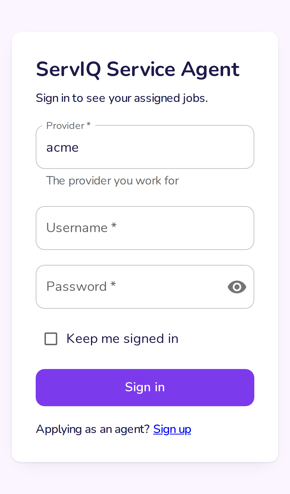
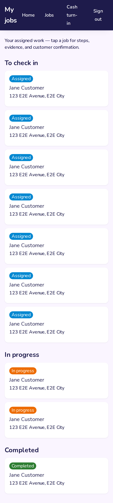
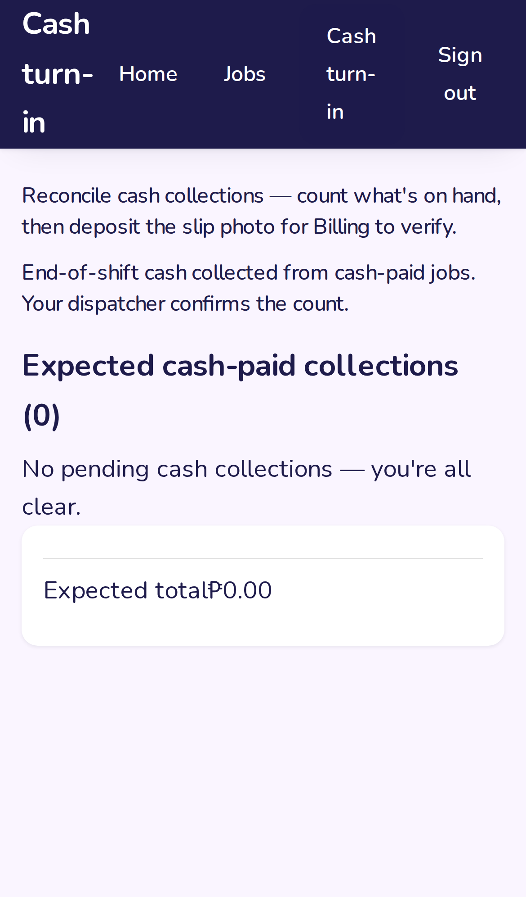

# Service Agent Portal — Guide

Field agent channel — mobile-first PWA for job execution and collection
turn-in. Screenshots are generated by
`scripts/screenshots/agent/field-workflow.mjs` (iPhone 13 viewport) —
regenerate on UI change, never hand-edit.

## Sign in

1. Open `http://localhost:3001/provider/acme/login` — enter username
   `anna.agent` and password, submit.

   

2. Home lists today's work.

   

## Work a job

3. Tap **Jobs** — assigned and offered jobs list here.

   

4. Tap a job — steps, evidence capture, and customer confirmation live
   on the detail page.

   

## Turn in collections

5. Tap **Cash turn-in** — expected total comes from the system; the
   agent counts what they hold and submits (or switches to a transfer
   rail with receipt upload).

   

> Anything the AI parsed (e.g. a receipt's reference/amount) is marked
> AI-read in the UI — the agent verifies it; the AI never settles money.
