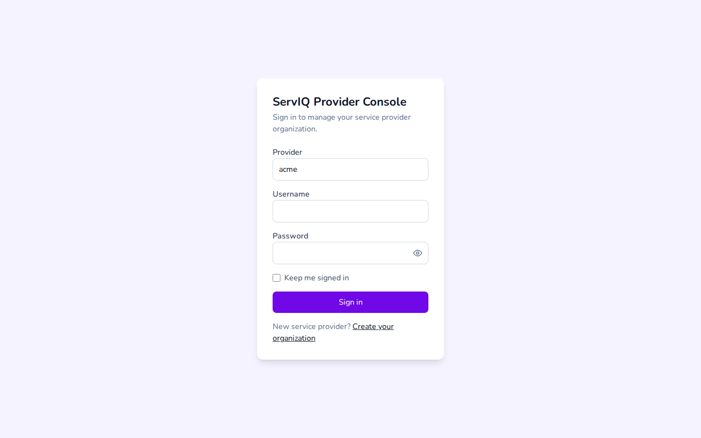
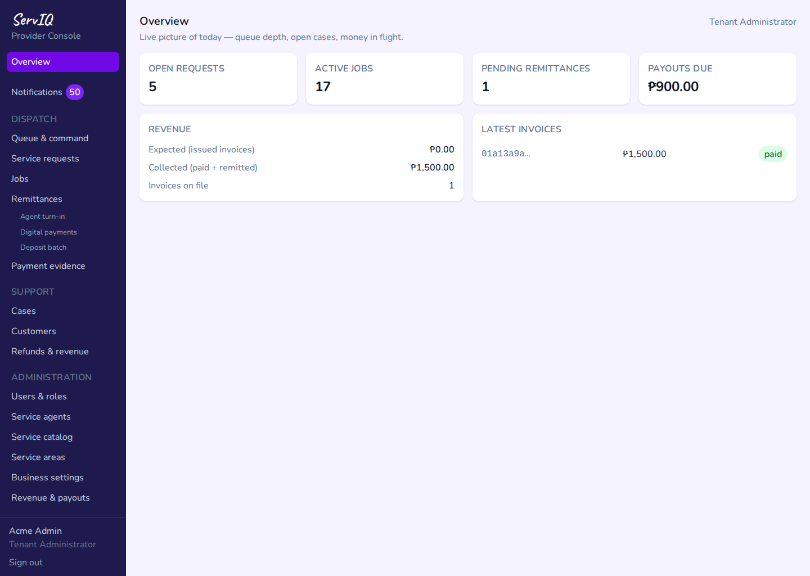
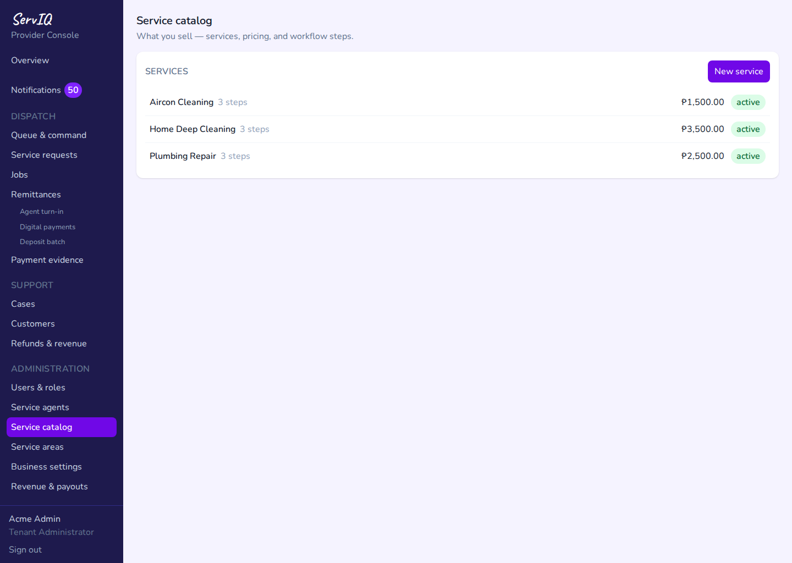
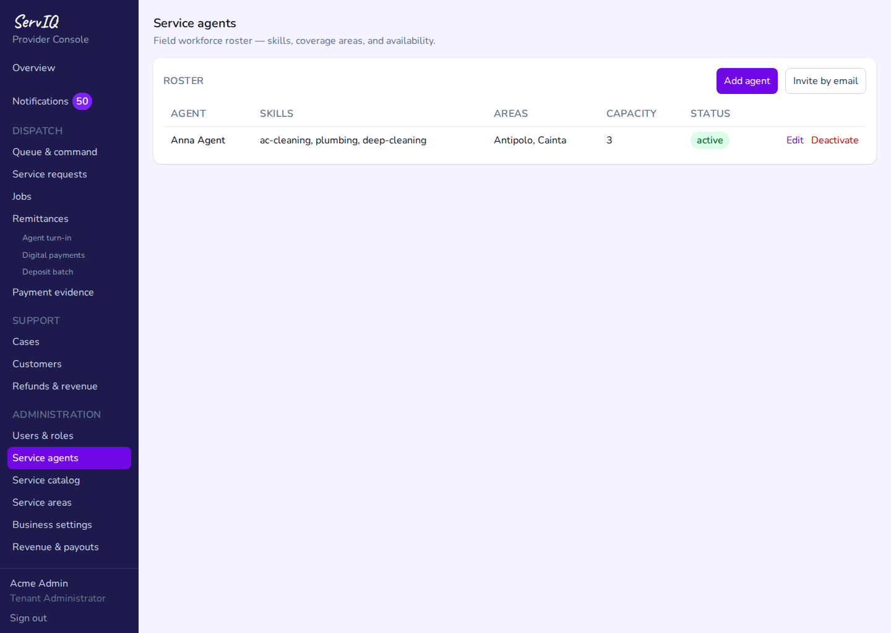
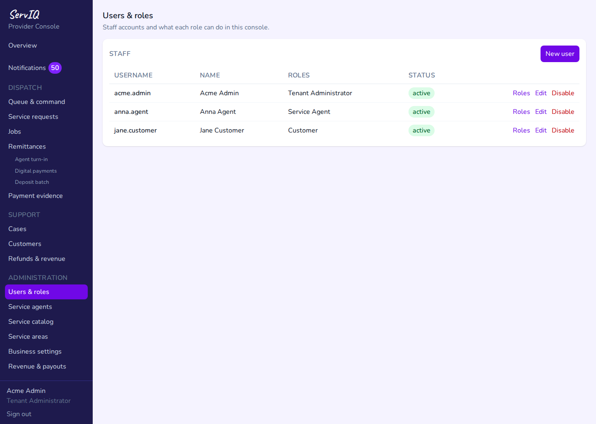
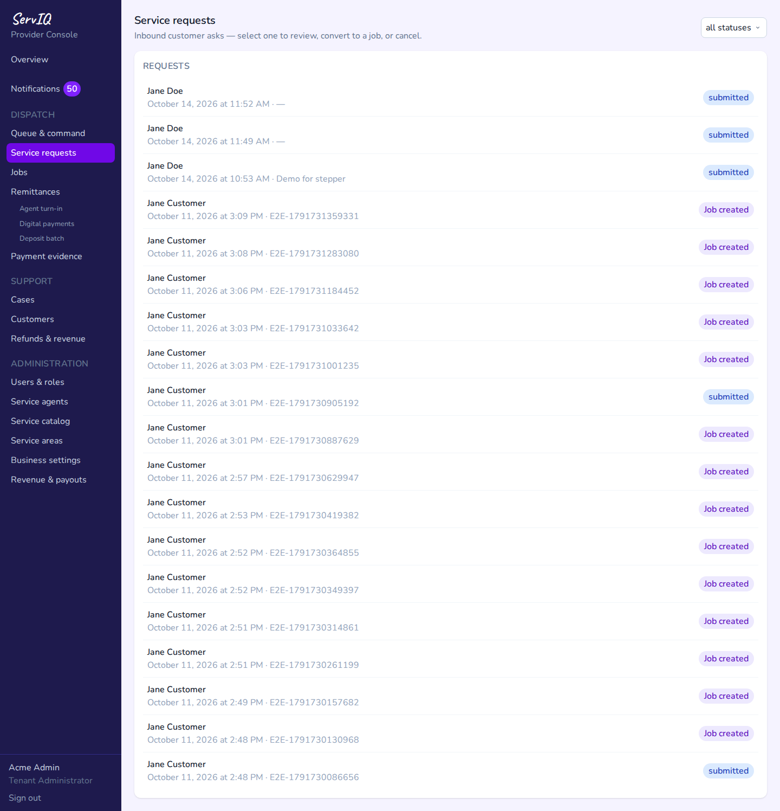
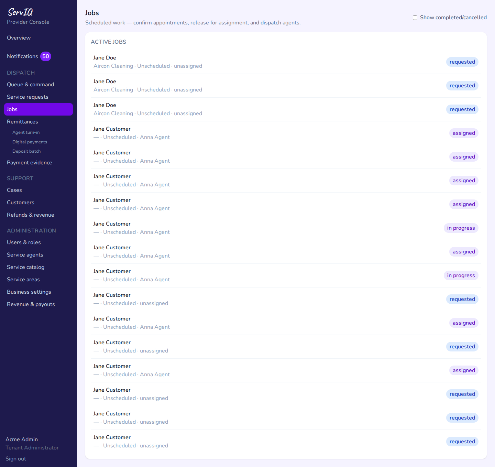
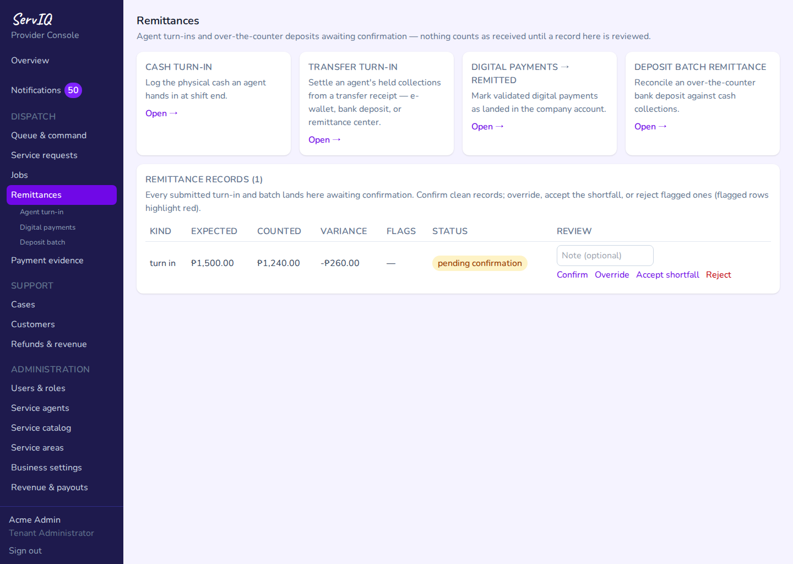
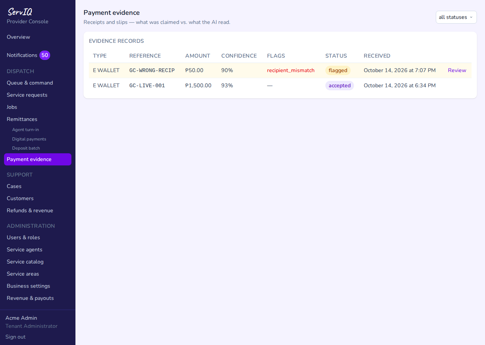

# Tenant Console — Guide

Provider back office — tenant administrators configure the business;
dispatchers run the queue and settle collections. Screenshots are
generated by `scripts/screenshots/console/tenant-ops.mjs` (desktop
viewport) — regenerate on UI change, never hand-edit.

## Sign in

1. Open `http://localhost:3002/provider/acme/login` — the Provider field
   carries the tenant slug; username `acme.admin`.

   

2. Overview — the console landing view.

   

## Tenant setup

3. **Service catalog** — what the provider sells; requests and bookings
   resolve against these services.

   

4. **Service agents** — the field roster dispatch draws from.

   

5. **Users & roles** — staff accounts and permission assignment.

   

## Dispatch and money

6. **Service requests** — the inbound queue; dispatch converts a request
   into a job here.

   

7. **Jobs** — work in flight, with status per assignment.

   

8. **Remittances** — agent turn-ins awaiting dispatcher review; expected
   vs. counted is compared here before confirm or reject.

   

9. **Payment evidence** — artifact-backed receipt and proof uploads
   (served through the `ArtifactStore` port, not direct storage calls).

   
