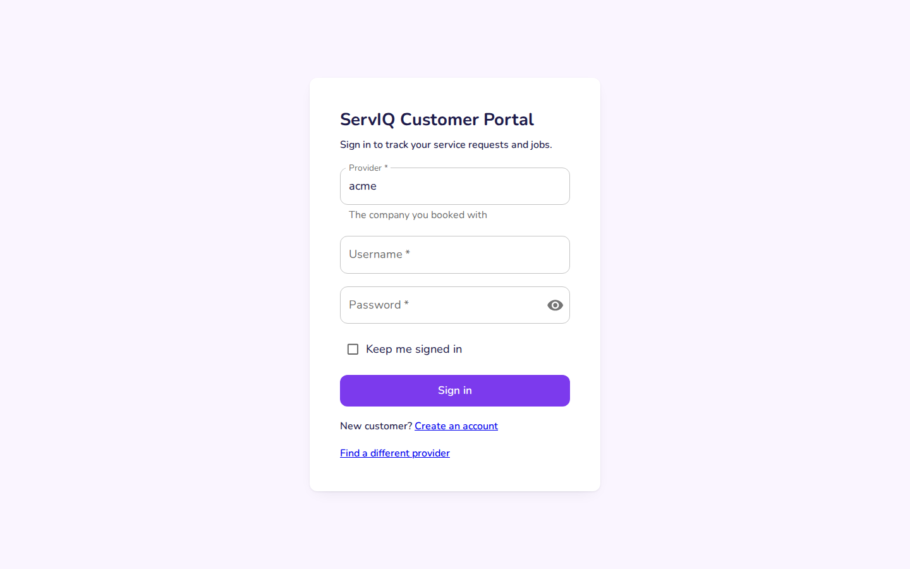
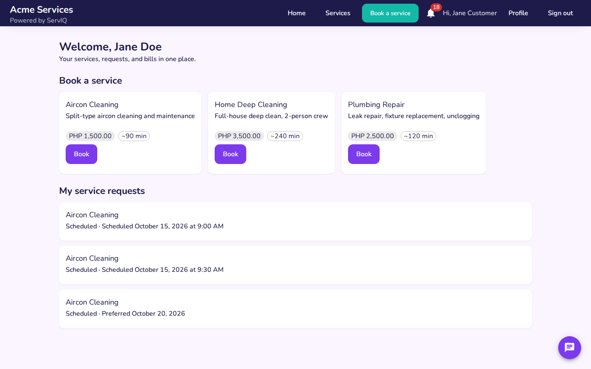
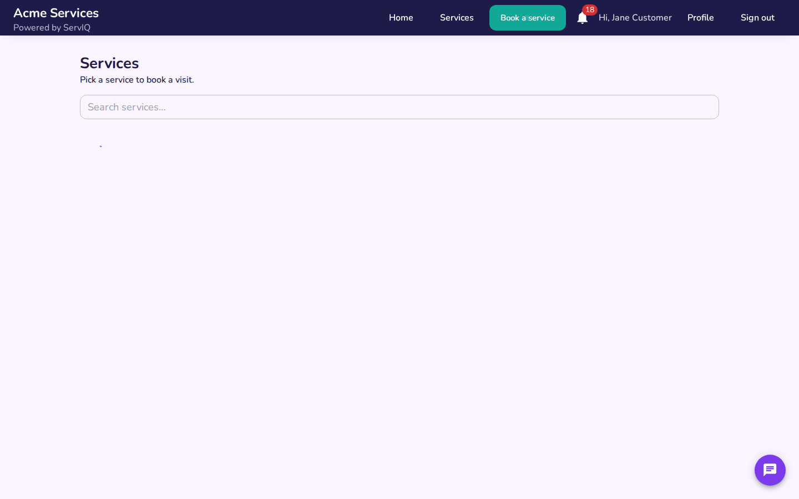
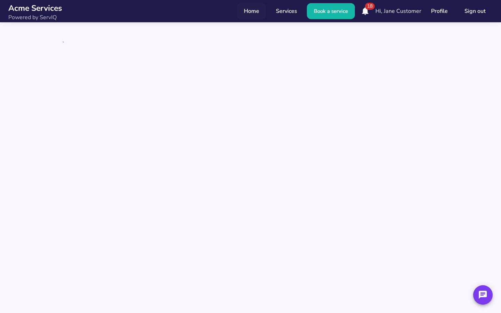
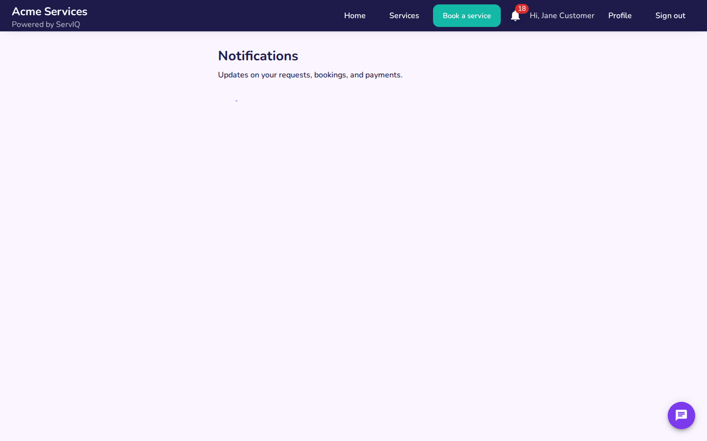

# Customer Portal — Guide

Customer channel — signup, service browsing, booking, and request
tracking. Screenshots are generated by
`scripts/screenshots/customer/booking.mjs` (desktop viewport) —
regenerate on UI change, never hand-edit.

## Sign in

1. Open `http://localhost:3000/provider/acme/login` — enter username
   `jane.customer` and password, submit.

   

2. Home — the provider's services plus the customer's recent requests.

   

## Book a service

3. **Catalog** — browse what the provider offers.

   

4. **Book** — scheduling and details form; submitting creates a service
   request that lands in the dispatcher's queue.

   

## Track and get notified

5. Opening a request shows its tracking detail — status moves as
   dispatch assigns and the agent executes.

   

6. **Notifications** — booking confirmations and status updates pushed
   by the notification service.

   
