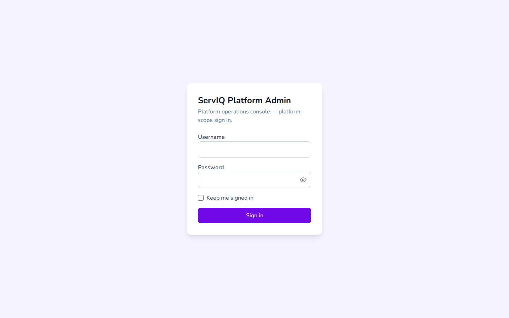
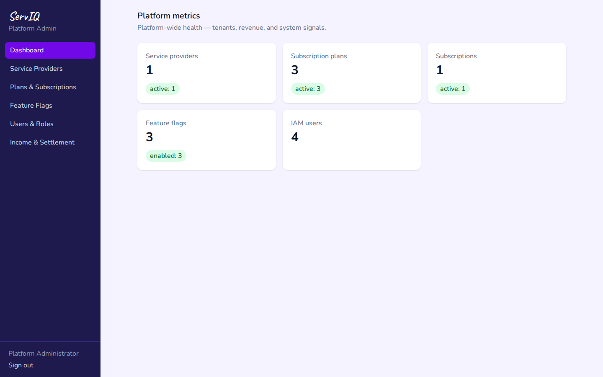
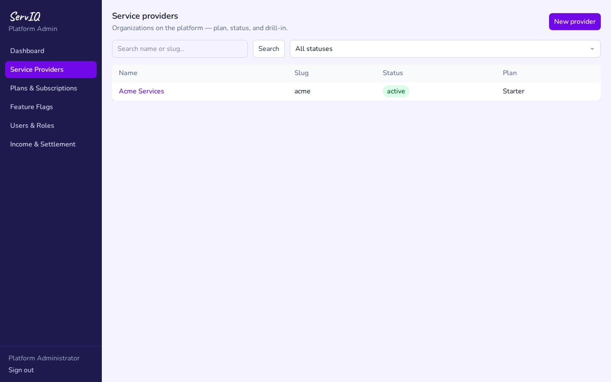
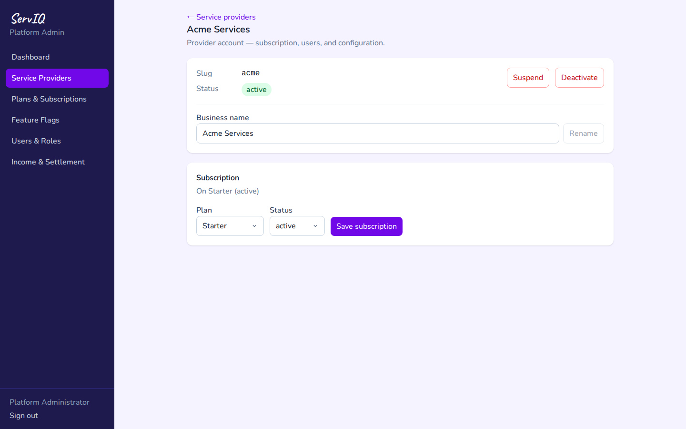
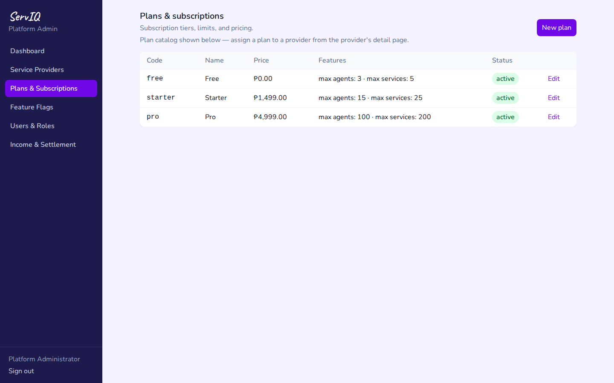
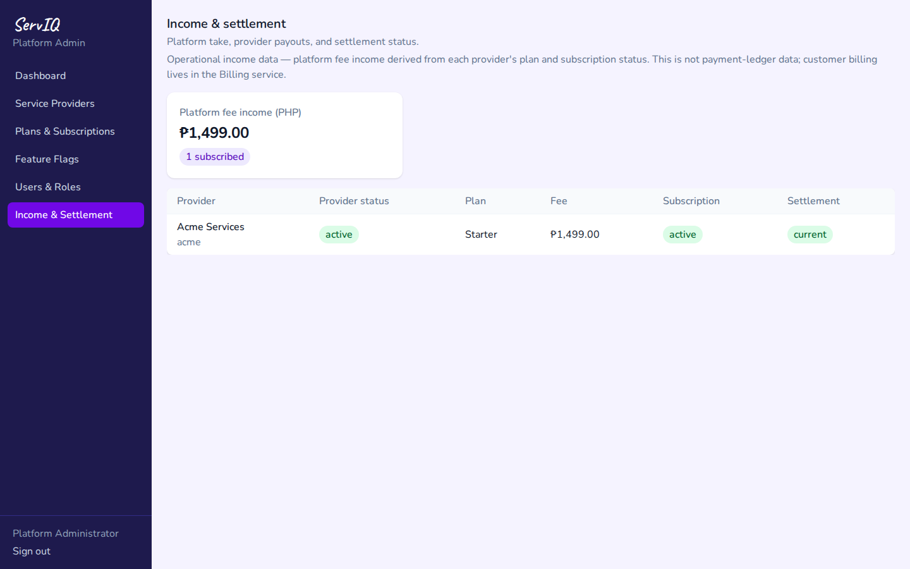

# Platform Admin Console — Guide

Operator tier — onboards service providers (tenants), manages plans,
feature flags, platform users, and settlement income. Screenshots are
generated by `scripts/screenshots/platform/provider-ops.mjs` (desktop
viewport) — regenerate on UI change, never hand-edit.

## Sign in

1. Open `http://localhost:3003/login` — platform scope, no tenant slug.
   Username `admin`.

   

2. Dashboard summarizes tenant count, revenue, and pending approvals.

   

## Manage providers

3. **Service Providers** lists every tenant with status.

   

4. Opening a provider shows its detail — activation controls, plan,
   and health.

   

## Plans and settlement

5. **Plans & Subscriptions** manages what each provider pays for.

   

6. **Income & Settlement** is the platform's revenue view across
   providers.

   
